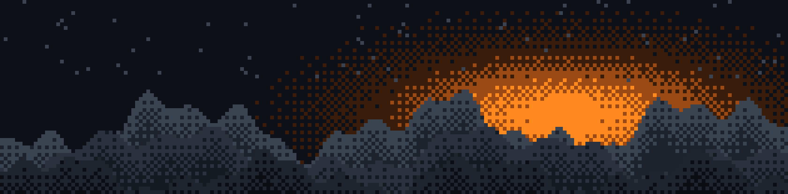
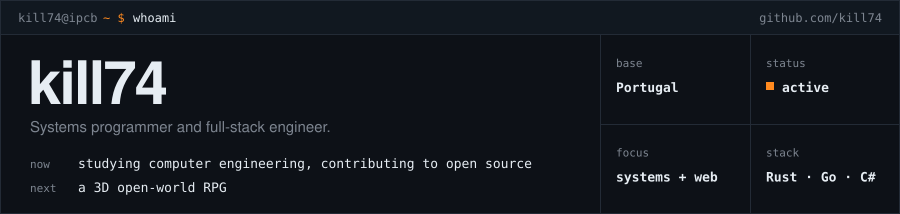
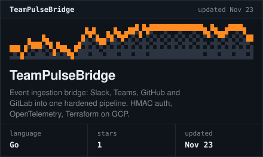
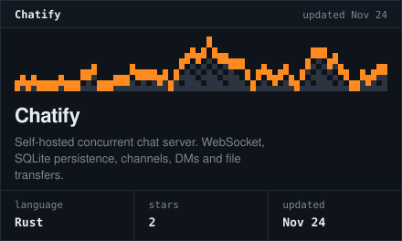
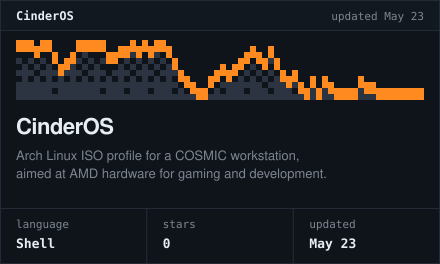
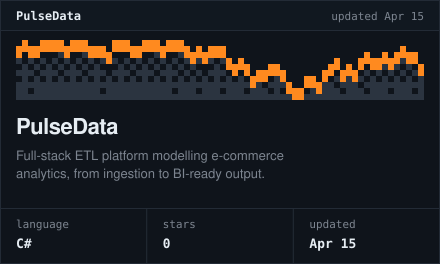
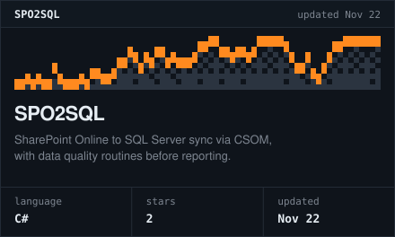
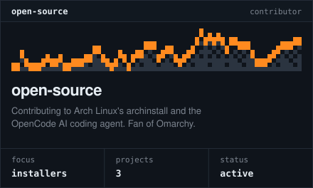
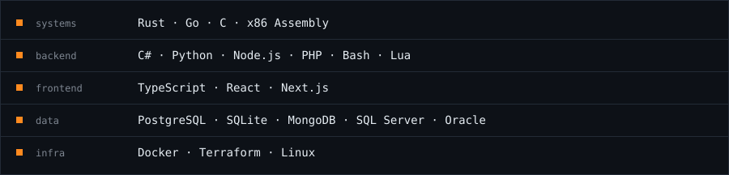

Systems programmer and full-stack engineer based in Castelo Branco, Portugal. Computer engineering student at [IPCB](https://www.ipcb.pt).

I work across the full stack, from bare-metal kernels and systems daemons up to REST APIs and production UIs. I care about software that is correct, observable and built to survive contact with production.

I love open source (●'◡'●)

### Work

### Stack

### Say hi

[Portfolio](https://guilhermewebsitee.vercel.app) · [LinkedIn](https://www.linkedin.com/in/guilherme-sales-35a580299) · guilhermesales4563@gmail.com
